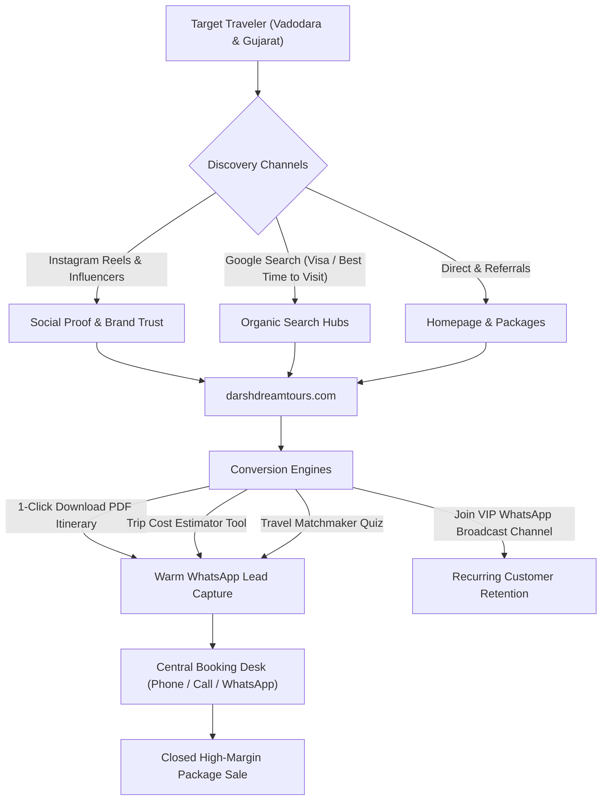

# Darsh Dream Tours: Growth Strategy & Feature Proposal

**Prepared For:** Sakshi Chandiramani  
**Target:** Scaling Inbound High-Intent Leads, Organic Search Reach & Regional Brand Dominance  
**Date:** November 2026  

---

## Executive Summary

While **darshdreamtours.com** currently features a high-end luxury aesthetic, an interactive 4-step consultation atelier, and 27 day-by-day itineraries, the primary business opportunity is transforming the website from a **passive digital brochure** into an **active lead-generation and conversion engine**.

By pairing high-intent website tools (instant cost calculators, 1-click PDF itinerary downloads, and a dedicated WhatsApp Broadcast Community) with targeted local social proof (Vadodara travel influencers, transparent OTA comparison, and specialized Jain/Veg travel hubs), we can systematically:
1. **Triple high-intent inquiry volume** without increasing paid advertising spend.
2. **Capture Gujarat’s affluent outbound travel market** (Vadodara, Ahmedabad, Surat) by directly solving their biggest anxieties (visa paperwork, authentic wholesale pricing, and pure vegetarian/Jain food abroad).
3. **Build an organic search moat (SEO)** targeting thousands of recurring monthly searches for visa checklists and holiday calendar guides.



---

## Pillar 1: High-Converting Lead Generation Engines

### 1.1 "1-Click Download Day-by-Day PDF Itinerary" (Every Package)
* **The Psychology:** When travelers research trips, they rarely book immediately. They save brochures and share itineraries on WhatsApp with their spouse, parents, or travel partners to discuss at dinner.
* **Current Limitation:** Visitors currently read on-screen and leave without leaving contact info.
* **The Proposed Feature:**
  * Every package card features a prominent secondary button: **"Download Detailed PDF Itinerary"**.
  * A 2-field micro-modal opens: *Full Name* and *WhatsApp Number*.
  * Instantly triggers the high-resolution branded PDF download (with Darsh Dream Tours letterhead, day-by-day schedule, hotel options, wholesale rate indicators, and desk contact numbers).
  * Simultaneously pings the lead to your desk via `/api/enquiry`: *"Aditya downloaded the 7-Day Japan Cherry Blossom PDF on WhatsApp"*.
* **Expected Impact:** Captures 25%–35% of currently anonymous package viewers as actionable warm leads.

### 1.2 "Check Today's Live Wholesale Rate & Availability" (Dynamic Quote Check)
* **The Reality:** Airfares, hotel inventory, and foreign exchange fluctuate daily and seasonally, meaning static price calculators risk misleading clients or locking into outdated rates.
* **The Proposed Feature:**
  * An interactive **Live Rate Checker** instead of a rigid price calculator.
  * Visitors select:
    1. **Destination:** (e.g. Dubai, Switzerland, Bali, Baku)
    2. **Travel Window:** (Specific month or flexible dates)
    3. **Hotel Tier:** (2★, 3★, 4★, or 5★)
    4. **Party Size:** (Guests & Kids)
  * Notice: *"Hotel & flight rates are dynamically quoted in real time based on live wholesale room blocks and airline tariffs."*
  * One-Click Action: **"Check Today's Lowest Live Rate on WhatsApp →"** (immediately opens WhatsApp with their exact trip blueprint pre-filled for an instant custom quote).
* **Expected Impact:** Protects the agency from price volatility while capturing high-intent quote requests effortlessly.

### 1.3 VIP WhatsApp Broadcast Channel / Community ("Secret Wholesale Drops")
* **User Insight:** Traditional email newsletters in India suffer from sub-15% open rates, whereas **WhatsApp broadcast channels and communities achieve 80%+ immediate read rates**.
* **The Proposed Feature:**
  * Add a dedicated, elegant ribbon across the site:
    > *"Join 1,200+ Smart Travelers in the Darsh VIP WhatsApp Broadcast Channel. Get 1 unadvertised wholesale flight drop and last-minute luxury stay offer every Friday. No spam, zero group noise."*
  * Uses WhatsApp Channel / Community links (`https://whatsapp.com/channel/...`) so members’ phone numbers remain completely hidden and private from other members.
* **Expected Impact:** Creates a recurring owned audience for unsold inventory, last-minute flight blocks, and off-season luxury resort deals.

---

## Pillar 2: Organic Google Search Magnets (Zero-Cost SEO Inbound)

### 2.1 Indian Passport Visa Guides & Requirement Hub
* **The Opportunity:** Queries like *"Dubai visa for Indians"*, *"Bali visa on arrival document checklist"*, *"Schengen visa requirements from Ahmedabad VFS"*, and *"Baku e-visa processing time"* generate over 250,000 monthly searches in Western India alone.
* **The Proposed Feature:**
  * Dedicated, clean documentation hubs for top 8 international corridors:
    1. **Dubai & UAE:** 14/30/60 Days tourist visa guidelines, photo specs, processing time (24–48 hrs).
    2. **Schengen (Switzerland, France, Austria):** Complete VFS appointment checklist, bank statement norms, travel insurance requirements.
    3. **Azerbaijan (Baku):** 3-day standard ASAN e-visa vs. 3-hour urgent visa guide.
    4. **Bali & Indonesia:** e-VoA application steps, customs declaration, tourist levy.
    5. **Japan:** Tourist eVisa process, financial proof requirements, single vs. multiple entry.
    6. **United Kingdom & Scotland:** Standard visitor visa processing times, biometric steps.
    7. **Thailand:** Visa exemption / VoA requirements and digital arrival cards.
    8. **Georgia & Caucasus:** E-visa conditions and valid US/UK/Schengen visa exemptions.
  * Every visa guide features an actionable sticky CTA: **"Skip the Paperwork — Have Our Visa Concierge Handle Your Filing"**.

### 2.2 Interactive "Month-by-Month" Travel Calendar
* **The Proposed Feature:**
  * An interactive visual calendar answering seasonal queries:
    * *Where to go in December?* (Dubai, Switzerland snow, Bali beaches, Rajasthan)
    * *Best summer family trips (May–June)?* (Kashmir, Himachal, Switzerland, UK, Singapore)
    * *Monsoon escapes (July–August)?* (Kerala, Bali, Ladakh)
    * *Diwali vacation circuits (October–November)?* (Japan autumn, Baku, Vietnam)
  * Filters destinations by temperature, flight duration, and family-friendliness.

---

## Pillar 3: City Media & Mega Lifestyle Influencer Campaign (Vadodara)

### 3.1 Why City Media & Lifestyle Creators Over Traditional Travel Creators
Traditional travel creators only reach people interested in solo backpacking or adventure. In contrast, **Vadodara’s affluent families, newlyweds, and business owners follow city media portals and top lifestyle influencers** for trusted local recommendations on weddings, shopping, dining, and family vacations.

When a 1.1M-follower authority like **@ourvadodara** or a top Baroda lifestyle creator posts about booking with Darsh Dream Tours, it provides immediate local credibility and triggers direct inquiries from high-budget clients.

---

### 3.2 Curated Roster: Top Vadodara Media Portals & Lifestyle Creators

| Platform / Creator & Handle | Followers | Profile & Audience | High-Converting Reel Concept for Darsh Tours |
| :--- | :--- | :--- | :--- |
| **OUR VADODARA™**<br>`@ourvadodara` | **1.1 Million+** | The #1 digital media and community platform in Baroda. Followed by families, business owners, and youth across Gujarat. | **"Planning your holiday from Vadodara? Here's why smart travelers are booking with Darsh Dream Tours instead of online portals"** (Feature Reel highlighting direct wholesale pricing, 24/7 human support, and zero convenience fees). |
| **Baroda Diaries**<br>`@barodadiaries` | **150K–250K** | Premier youth & city discovery channel covering top experiences and lifestyle spots. | **"Top 5 International Trips Under ₹65k for Barodians This Season"** (Featuring Baku, Bali, Dubai, Thailand with 1-click booking desk info). |
| **Tarnnum Shaikh**<br>`@tarnnumshaikh` | **~1 Million** | Macro lifestyle, aesthetic diaries, and high-engagement content creator based in Vadodara. | **Aesthetic Holiday / Couple Reel**: Showcasing luxury stays, panoramic views, and customized private itineraries (Switzerland, Maldives, Japan). |
| **Sakshi Prajapati**<br>`@sakshi_4131` | **~780K+** | Mega fashion, beauty, and travel lifestyle creator. Enormous reach among brides, couples, and young families. | **Honeymoon & Luxury Travel Series**: *"Pack with me for Europe / Bali with our custom Darsh Tours itinerary"*. |
| **Kalp Vaidya**<br>`@kalpvaidya` | **~335K+** | Men's lifestyle, luxury, and travel creator with massive regional youth & corporate following. | **"How We Got Direct Wholesale Rates on 5-Star Stays Abroad"**: Revealing how Darsh beats portal pricing. |
| **Pooja Desai**<br>`@poojadesai` | **~170K+** | Mrs. India 2020 winner; represents affluent family travel, wellness, and luxury holidays. | **Family Vacation & Jain/Veg Dining Reel**: *"Traveling to Europe with family? How Darsh Dream Tours arranged guaranteed pure vegetarian meals every single day"*. |
| **Rini Dixit**<br>`@_rinidixit` | **~140K+** | Top Baroda lifestyle and beauty creator with deeply engaged female and family audience. | **Girls' Trip / Family Break Reel**: Weekend & international vacation planning made effortless. |

---

### 3.3 The 3 High-Impact Reel Formats to Run

1. **Format 1: "Portals vs. Local Wholesale" (Comparison Reel)**
   * *Hook:* "Are you paying 20% extra convenience fees on MakeMyTrip / Agoda?"
   * *Story:* Show a side-by-side comparison of a 5-star Dubai or Bali stay on a booking portal vs. Darsh Dream Tours direct wholesale rate, showing savings of ₹15,000–₹35,000 + guaranteed 24/7 human SOS support.
2. **Format 2: "The Pure Veg & Jain Travel Secret" (Food Assurance Reel)**
   * *Hook:* "The biggest reason Gujaratis hesitate to travel abroad is food. Here is how we fixed it."
   * *Story:* Highlighting guaranteed pure vegetarian and Jain dining in Switzerland, Baku, Japan, and Vietnam.
3. **Format 3: "Top 3 Winter / Summer Escapes from Vadodara"**
   * *Hook:* "Looking for a vacation from Vadodara next month?"
   * *Story:* Featuring quick visa-on-arrival or e-visa destinations (Dubai, Baku, Bali) with day-by-day plans.

---

### 3.2 "Why Book With Us vs. Online Portals (OTAs)" Comparison Matrix
Add a dedicated section directly addressing the pitfalls of booking on Booking.com / MakeMyTrip / Agoda:

| Feature / Service | Online Portals (MakeMyTrip, Agoda, Booking.com) | Darsh Dream Tours Concierge |
| :--- | :--- | :--- |
| **Pricing** | Marked up with 15%–25% commissions + convenience fees | **Direct B2B wholesale net rates** with zero surprise markups |
| **Dietary Requirements** | Standard hotel breakfast buffet only; zero Jain/Veg guarantees | **Guaranteed Pure Vegetarian & Jain dining arrangements** across global cities |
| **Emergency Support** | Automated IVR menus & overseas call-center ticket queues | **24/7 Direct WhatsApp & Phone access** to your designated desk manager |
| **Itinerary Flexibility** | Rigid pre-packaged bus tours with fixed 50-person departures | **100% Bespoke day-by-day plans**, private chauffeurs & self-paced mornings |
| **Visa & Document Support** | Third-party outsourced links or DIY paperwork | **In-house Visa Concierge** handling VFS appointments, forms, and review |

---

### 3.3 Real Traveler Case Studies & Photo Highlights
* Feature 4–6 authentic trip snapshots:
  * *"The Shah Family in Lucerne: 8 Days with Swiss Rail Passes and Gujarati Dining"*
  * *"Honeymoon in Baku: 5 Nights at Fairmont Flame Towers with Private Mercedes Chauffeur"*
  * *"Corporate Retreat in Dubai: 35 Executives at Atlantis The Palm"*

---

## Pillar 4: Interactive "Travel Matchmaker" 30-Second Quiz

* **The Concept:** A playful, highly visual 4-question quiz that recommends the perfect destination:
  * **Question 1 (Travel Party):** Couple / Honeymoon | Family with Kids | Solo Explorer | Friends Group
  * **Question 2 (The Vibe):** Snow & Alpine Glaciers | Tropical Beaches & Overwater Villas | Futuristic Skylines & Theme Parks | Royal Palaces & Cultural Heritage
  * **Question 3 (Flight Duration):** Short Haul (< 4.5 Hours) | Long Haul Signature Voyage
  * **Question 4 (Travel Pace):** Relaxed & Luxurious | Action-Packed & Full Discovery
* **The Result:**
  * Instantly reveals the top 2 matching destinations (e.g. *“Your ideal match is Baku, Azerbaijan!”*).
  * Displays the day-by-day itinerary summary, recommended hotel stars, and a direct 1-click **"Chat with Desk About This Match"** button.
* **Viral Element:** Users can share their match on WhatsApp and Instagram Stories with a custom card.

---

## Pillar 5: High-Margin Niche Corridors

### 5.1 Dedicated "Pure Vegetarian & Jain Global Travel" Hub
* **Why it is crucial for Gujarat:** Over 70% of high-net-worth families in Vadodara and Ahmedabad prioritize food assurance above all else when traveling abroad.
* **The Hub Inclusions:**
  * Verified list of pure vegetarian/Jain restaurants in Switzerland, Japan, Baku, Bali, and Dubai.
  * Information on Indian Chef kitchen caravans for private group tours.
  * Pre-arranged hotel breakfast tie-ups guaranteeing vegetarian food without cross-contamination.

### 5.2 Corporate Retreats & Group MICE Desk
* Dedicated portal for Vadodara businesses, pharmaceutical companies, engineering firms, and trade associations:
  * Annual Dealer Meets & Incentive Tours (Dubai, Thailand, Goa, Sri Lanka).
  * Private flight charter assistance & bulk group ticketing.
  * Direct GSTIN billing for corporate tax credit compliance (`GSTIN: 24AAZFD6999A1ZU`).

---

## Implementation Roadmap & Approval Checklist

```mermaid
flowchart LR
    subgraph Phase 1 ["Phase 1: Quick Wins (Week 1)"]
        P1A["1-Click PDF Itinerary Download"]
        P1B["Instant Travel Budget Calculator"]
        P1C["VIP WhatsApp Broadcast Ribbon"]
    end
    
    subgraph Phase 2 ["Phase 2: Growth & SEO (Week 2)"]
        P2A["Indian Passport Visa Guides"]
        P2B["Portal vs Darsh Comparison Matrix"]
        P2C["30-Second Travel Matchmaker Quiz"]
    end
    
    subgraph Phase 3 ["Phase 3: Community & Outreach (Week 3)"]
        P3A["Vadodara Influencer Outreach"]
        P3B["Jain & Veg Global Travel Hub"]
        P3C["Corporate MICE Landing Desk"]
    end
    
    Phase 1 --> Phase 2 --> Phase 3
```

---

## Decisions Needed from Sakshi Chandiramani

1. **WhatsApp Broadcast Channel / Community**:
   * Do you have an existing WhatsApp Channel/Community created, or should we set up a dedicated link (e.g., *Darsh Dream Tours VIP Travel Club*)?
2. **Influencer Outreach Priority**:
   * Which profile should we prioritize first for Vadodara promotion:
     * *Option A:* Broad family/couple reach (e.g. **Vlog with Nehu** or **Kalp Vaidya**)?
     * *Option B:* Food & Jain/Veg specialty trust (e.g. **Shruti @hungryshruu**)?
3. **Phase 1 Feature Prioritization**:
   * Can we proceed with deploying **Feature 1A (PDF Itinerary Downloads)** and **Feature 1B (Interactive Budget Calculator)** to start collecting leads immediately?
